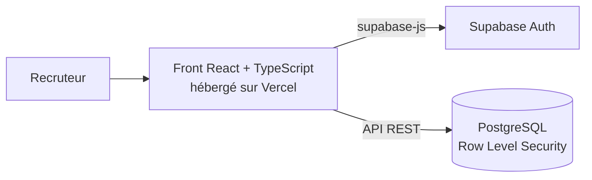

# Persora RH — sourcing de candidats pour la sécurité hôtelière

Application web de **présélection de candidats** pour des postes d'agent de sécurité en hôtellerie de luxe.
Projet annuel certifiant du Bachelor Data & Business Intelligence (NEXA Digital School, titre RNCP40857), réalisé pour un client du secteur de la sécurité privée.

**🔗 Démo en ligne : [persora-7q0ifzwe2…](https://persora-7q0ifzwe2-babootarienathan-3198s-projects.vercel.app)** · compte lecture seule : `lecture@crono-securite-demo.fr` / `Persora2026!`

**Stack** : React 18 · TypeScript · Vite · Supabase (PostgreSQL, Auth, Row Level Security) · Vercel

## Le besoin

Le recrutement d'agents de sécurité pour l'hôtellerie de luxe demande de vérifier, pour chaque candidat, des éléments précis : carte professionnelle, diplômes SSIAP ou SST et leurs dates d'expiration, expérience, disponibilité. Ces informations sont dispersées entre plusieurs plateformes d'emploi. Le recruteur perd du temps à les rassembler avant même le premier appel.

## Ce que fait l'application

- **Vivier de candidats** : liste des profils repérés, avec leur statut dans le processus (nouveau, contacté, qualifié, entretien, embauché, refusé) et des indicateurs de suivi.
- **Fiche candidat** : expérience, disponibilité, certifications avec date d'expiration et statut de vérification.
- **Score de savoir-être indicatif** : affiché comme une aide à la présélection, avec un avertissement explicite. Aucune décision n'est prise automatiquement (article 22 du RGPD).
- **Gestion du consentement RGPD** : chaque candidat a un statut (en attente, informé, opposé) et chaque action est historisée.
- **Authentification** : trois rôles prévus (responsable RH, chargé de recrutement, lecture seule).

## Architecture



Pas de backend séparé : Supabase fournit l'API, la base et l'authentification. La sécurité repose sur les politiques **Row Level Security** de PostgreSQL. La clé publique Supabase présente dans le code est prévue pour être exposée côté client.

## Modèle de données

| Table | Rôle |
|---|---|
| `candidates` | Profils repérés : expérience, disponibilité, score indicatif, statut, consentement |
| `certifications` | Carte professionnelle, SSIAP, SST : date d'expiration, vérification |
| `consent_events` | Historique RGPD : information du candidat, opposition |
| `sourcing_sources` / `sourcing_jobs` | Sources de sourcing et exécutions de collecte |
| `staff_users` | Utilisateurs internes et leur rôle |
| `audit_logs` | Journal des actions |

Les scripts sont dans [`database/`](database/), à exécuter dans l'ordre : schéma, données de démonstration, comptes de test, puis renforcement de la sécurité.

## Sécurité : droits par rôle

Les droits sont appliqués directement dans PostgreSQL par des politiques **Row Level Security** :

| Action | Visiteur non connecté | Lecture seule | Recruteur | Responsable RH |
|---|---|---|---|---|
| Consulter les candidats | ✗ | ✓ | ✓ | ✓ |
| Modifier un statut | ✗ | ✗ | ✓ | ✓ |
| Enregistrer un consentement RGPD | ✗ | ✗ | ✓ | ✓ |
| Gérer les sources de sourcing | ✗ | ✗ | ✗ | ✓ |
| Lire le journal d'audit | ✗ | ✗ | ✗ | ✓ |

Ces règles ont été testées en simulant chaque rôle directement en base.

## RGPD : les choix de conception

- Les candidats sont identifiés nommément : un statut de consentement et une table d'historique (`consent_events`) permettent d'appliquer le droit d'information et d'opposition (article 14).
- Le score de savoir-être reste un indicateur pour le recruteur, jamais un critère de décision automatique (article 22).
- Les données de ce dépôt sont **entièrement fictives** (« Candidat Démo A, B, C »).

## Lancer le projet

```bash
npm install
npm run dev
```

Compte de démonstration en lecture seule : `lecture@crono-securite-demo.fr` / `Persora2026!`

## Limites et suite

- Le pipeline de collecte et d'analyse des profils (Python) n'est pas publié dans ce dépôt.

---
Nathan Babootarie · Mastère Data & IA · en recherche d'alternance Data Analyst · [LinkedIn](https://linkedin.com/in/nathan-babootarie)
